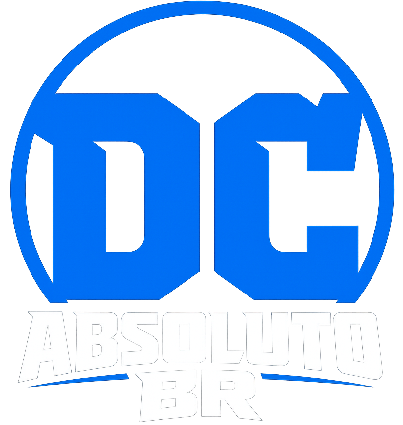
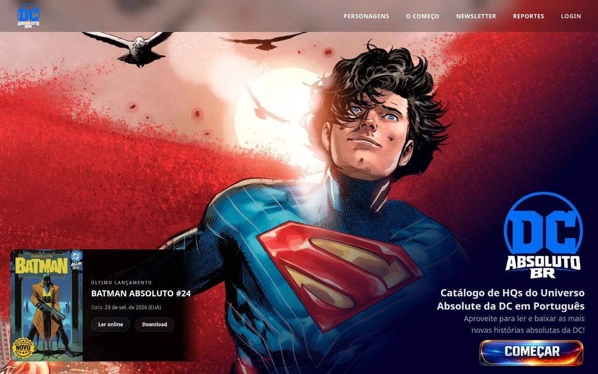
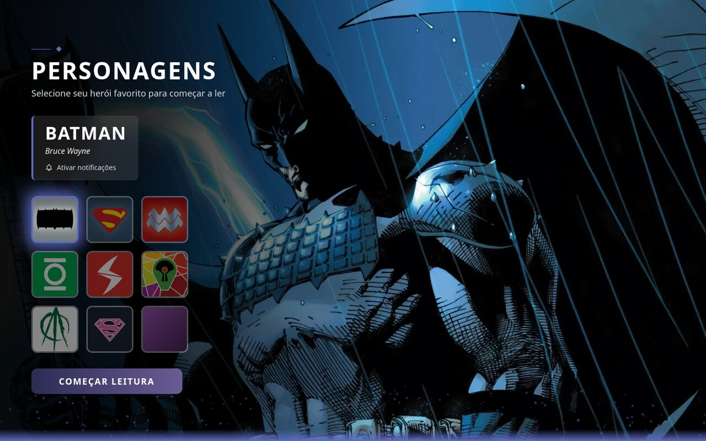
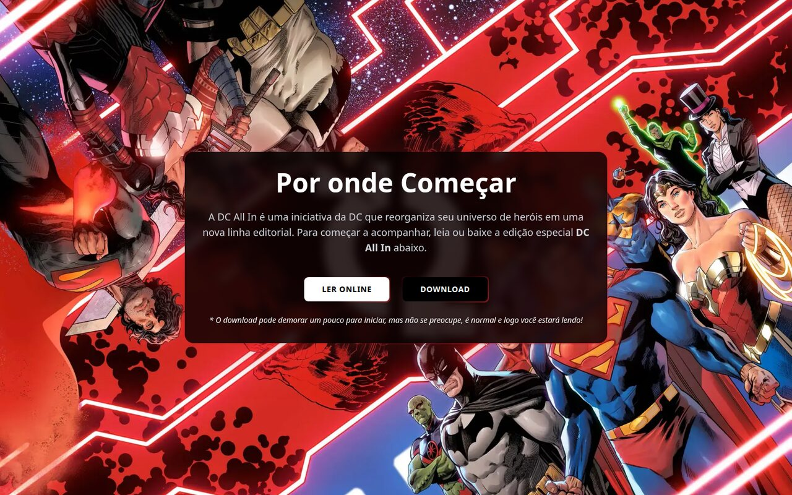
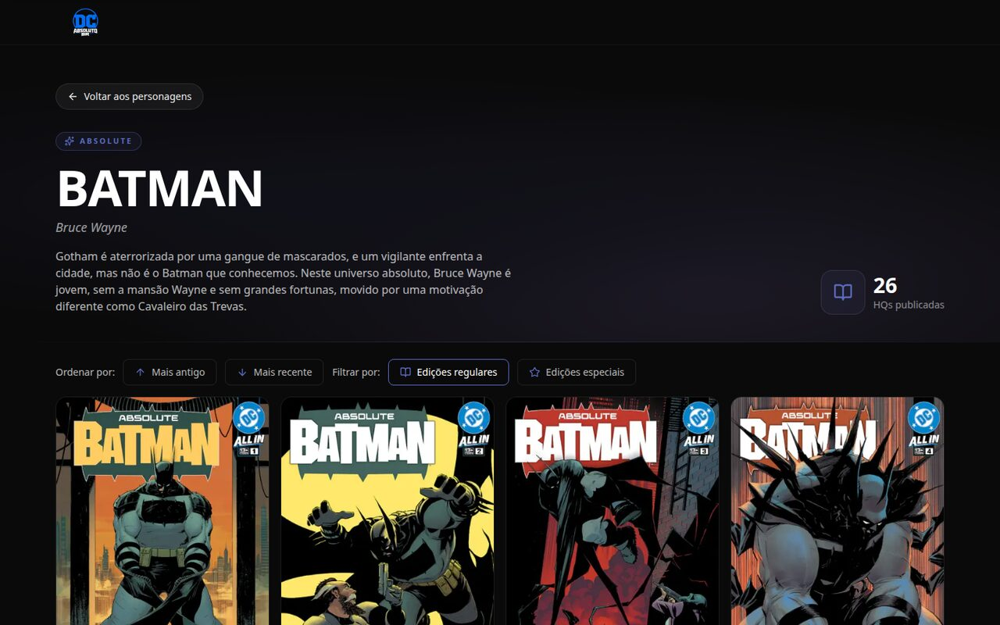
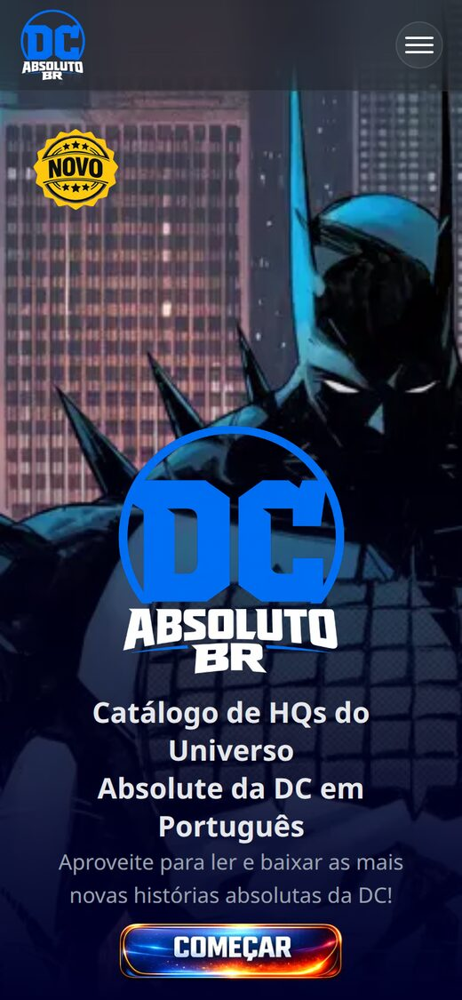
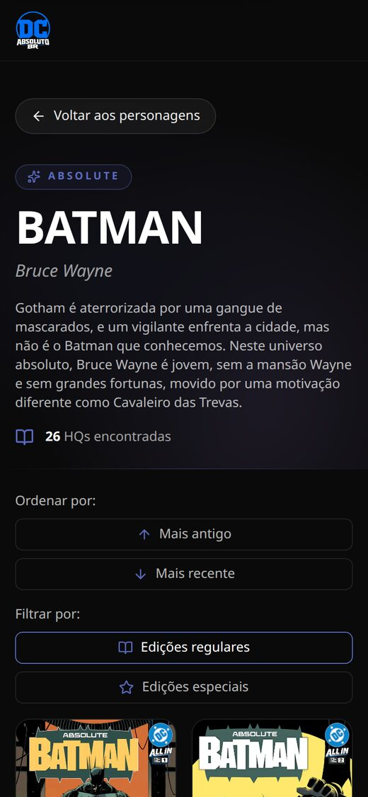
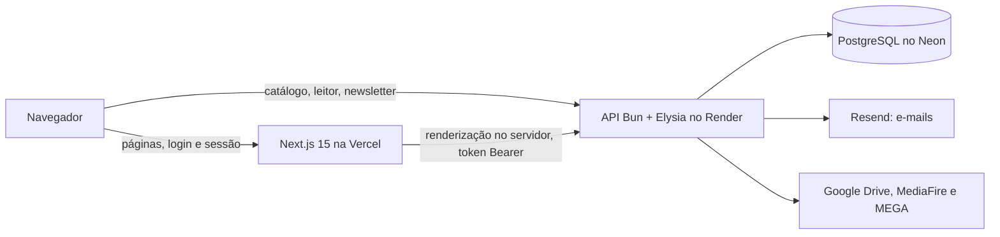

<div align="center">

<a href="https://dc-absoluto-br.com.br">
  
</a>

# DC Absoluto BR

Catálogo feito por fã, em português, das HQs do Universo Absolute da DC.
Leia online, baixe, marque o que já leu e receba aviso quando sair edição nova.

[](https://dc-absoluto-br.com.br)


-94-0CCE6B?style=flat-square&logo=lighthouse&logoColor=white)


</div>

> [!IMPORTANT]
> O DC Absoluto BR é um projeto de fã, sem fins lucrativos e sem ligação com a DC Comics ou a Warner Bros. Discovery. Todos os personagens, capas, imagens e marcas que aparecem aqui pertencem à **DC Comics** e aos seus respectivos detentores. As traduções são do **[Darkseid Club](https://site.ds-club.net/)**. O site não vende nada e não exibe anúncios.

<p align="center">
  
</p>

## Sumário

- [Funcionalidades](#-funcionalidades)
- [Telas](#-telas)
- [Performance](#-performance)
- [SEO](#-seo)
- [Acessibilidade](#-acessibilidade)
- [Segurança](#-segurança)
- [Testes](#-testes)
- [Arquitetura e stack](#-arquitetura-e-stack)
- [Direitos e créditos](#-direitos-e-créditos)

## ✨ Funcionalidades

### Catálogo

- Nove personagens: Batman, Superman, Mulher Maravilha, Lanterna Verde, Flash, Caçador de Marte, Arqueiro Verde, Supergirl e Mulher-Gato.
- Cada personagem pode ter mais de um universo (Absolute, Terra Um e outros que forem cadastrados).
- A lista de HQs ordena da mais antiga para a mais recente (ou o contrário) e separa edições regulares de especiais. Sinopses longas abrem com "ler mais".
- A home destaca o último lançamento, com botões para ler online ou baixar.
- A seção "Por onde começar" traz a edição especial DC All In para quem está chegando agora.

### Leitor online

- Abre CBR, CBZ e PDF direto no navegador. Os arquivos compactados são extraídos com libarchive.js (WebAssembly, num Web Worker) e os PDFs com PDF.js.
- Tem zoom, tela cheia, modo de página dupla e atalhos de teclado: setas e espaço para virar a página, Home e End para ir ao começo ou ao fim, F para tela cheia e D para página dupla.
- Lembra a página em que você parou e oferece retomar a leitura.
- Guarda as páginas extraídas no IndexedDB, então a segunda leitura da mesma HQ abre sem baixar de novo.
- Os downloads passam por um proxy da API que entende links do Google Drive, MediaFire e MEGA.

### Conta e progresso

- Cadastro com confirmação por e-mail, login, recuperação de senha e troca de senha no perfil.
- Você marca as HQs que já leu e acompanha o total por personagem.
- Seis níveis de leitor, cada um com sua moeda: Bronze (10 HQs), Prata (30), Ouro (50), Diamante (70), Kryptonita (100) e Absoluto (150).
- O perfil tem foto (avatares de personagens), nome editável, conquistas e os personagens que você mais lê.
- Um card de identidade público, com link próprio, para compartilhar no WhatsApp.

### Comunidade

- Newsletter geral e aviso por personagem quando entra HQ nova.
- Formulário de reporte para link quebrado, erro de tradução ou qualquer outro problema.

### Administração

- Uma área restrita ao administrador cadastra novas HQs pelo navegador, com uma sessão própria que expira em 30 minutos.

## 📸 Telas

<table>
  <tr>
    <td width="50%"></td>
    <td width="50%"></td>
  </tr>
  <tr>
    <td align="center">Home e último lançamento</td>
    <td align="center">Seleção de personagens</td>
  </tr>
  <tr>
    <td width="50%"></td>
    <td width="50%"></td>
  </tr>
  <tr>
    <td align="center">Por onde começar</td>
    <td align="center">HQs do Batman Absolute</td>
  </tr>
</table>

<p align="center">
  
  &nbsp;&nbsp;
  
</p>

## 🚀 Performance

Medição com Lighthouse 12.8 na home de produção (desktop), em 16/10/2026:

| Performance | Acessibilidade | Boas práticas | SEO |
|:-----------:|:--------------:|:-------------:|:---:|
| 94          | 100            | 100           | 100 |

O primeiro conteúdo aparece em 0,7 s e o maior elemento da tela em 1,0 s, com deslocamento de layout (CLS) de 0,009.

O que ajuda o site a carregar rápido:

- Imagens em WebP servidas pelo `next/image`, com tamanhos responsivos e carregamento sob demanda.
- Assets estáticos com cache imutável de um ano.
- A API manda `Cache-Control` com `stale-while-revalidate`: a lista de personagens fica em cache por 7 dias, a última HQ por 1 dia e as listas de HQs por 3 minutos.
- As páginas são renderizadas no servidor (App Router), e o sitemap é revalidado uma vez por semana.
- As partículas do rodapé só animam quando o rodapé está visível (IntersectionObserver).
- O leitor extrai os arquivos num Web Worker e reaproveita as páginas do IndexedDB.

## 🔎 SEO

- Metadados por página, com template de título (`%s | DC Absoluto BR`), descrição e URL canônica.
- Open Graph e Twitter Card (`summary_large_image`) no site, nas páginas de personagem e nos cards de perfil.
- `sitemap.xml` gerado a partir dos personagens cadastrados.
- `robots.txt` liberando o site e bloqueando `/api` e `/adicionar`, que também tem `noindex`.
- HTML semântico com `lang="pt-BR"`.

## ♿ Acessibilidade

- Nota 100 no Lighthouse.
- 12 verificações automáticas com axe-core (vitest-axe) rodam junto com os testes do front.
- Link "Pular para conteúdo principal" no topo de todas as páginas.
- Controles com `aria-label` (seleção de personagem, botões do leitor, menus) e modais com título associado.
- Com `prefers-reduced-motion`, as animações em CSS e a rolagem por seções são desligadas.
- Dá para ler uma HQ do começo ao fim só com o teclado, usando os atalhos do leitor.

## 🔐 Segurança

- A sessão é um token assinado com HMAC-SHA256 num cookie `HttpOnly` e `SameSite`. O JavaScript da página não lê nem consegue forjar a sessão.
- As senhas são guardadas com o hash do `Bun.password` (argon2). Os tokens dos links de e-mail ficam no banco só como hash SHA-256 e valem uma vez.
- Login, login de admin, troca de senha, envio de e-mails e reportes têm limite de tentativas.
- As rotas que mudam estado no site conferem a origem da requisição (proteção contra CSRF), e a API só aceita chamadas do navegador vindas do próprio site (CORS).
- O proxy de download só busca Google Drive, MediaFire, MEGA ou links de HQs cadastradas, e recusa endereços internos (proteção contra SSRF).
- Os headers de segurança (`X-Frame-Options`, `nosniff`, `Referrer-Policy`, CSP `frame-ancestors`) vão em todas as respostas, e erros inesperados respondem com uma mensagem genérica, sem detalhes internos.
- Nome e mensagens enviados por usuários entram escapados no HTML dos e-mails.

## 🧪 Testes

São 151 testes automatizados:

| Pacote                     | Ferramentas                                     | Testes |
|----------------------------|-------------------------------------------------|:------:|
| `apps/web`                 | Vitest, React Testing Library, axe-core          | 83     |
| `apps/api`                 | `bun test`                                      | 57     |
| `packages/shared-schemas`  | Vitest                                          | 11     |

Os testes cobrem as seções da home, o formulário de admin, a sessão assinada, o limitador de tentativas, o proxy de download (incluindo os casos de SSRF), CORS, CSRF, newsletter, reportes e acessibilidade.

## 🏗️ Arquitetura e stack



**Frontend (`apps/web`)**: Next.js 15 com React 19, Tailwind CSS v4, TanStack Query, libarchive.js e PDF.js no leitor, Vitest e React Testing Library nos testes.

**Backend (`apps/api`)**: Bun com Elysia, Drizzle ORM, PostgreSQL no Neon e Resend para os e-mails.

**Monorepo**: Turborepo com pnpm workspaces e Biome para lint e formatação. Os pacotes `shared-types` e `shared-schemas` (Zod) são usados pelo web e pela API.

```
dc-absoluto-br/
├── apps/
│   ├── web/              # Frontend Next.js
│   └── api/              # Backend Elysia/Bun
├── packages/
│   ├── shared-types/     # Interfaces TypeScript e token de sessão compartilhados
│   └── shared-schemas/   # Schemas Zod compartilhados
└── docs/images/          # Imagens deste README
```

## ⚖️ Direitos e créditos

Este é um projeto de fã, pessoal e sem fins lucrativos, feito para reunir num só lugar as HQs do Universo Absolute em português.

Todos os direitos sobre personagens, histórias, capas, imagens e marcas exibidos no site pertencem à **DC Comics** e aos seus respectivos detentores.

As traduções para o português são do **[Darkseid Club](https://site.ds-club.net/)**. Se você curte ler essas HQs em português, siga e apoie o trabalho deles.

O código-fonte do site e da API é de [petrecaLeo](https://github.com/petrecaLeo).

Se você é detentor de algum desses direitos e quer que um conteúdo seja retirado, use o formulário de reportes do site.

## Autor

Desenvolvido por [petrecaLeo](https://github.com/petrecaLeo).

## Licença

© 2026 petrecaLeo. Todos os direitos reservados sobre o código. Personagens, imagens e marcas da DC pertencem à DC Comics; as traduções pertencem ao Darkseid Club.
